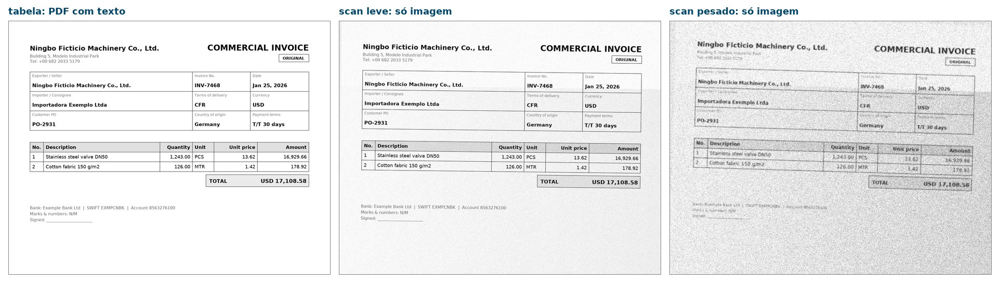
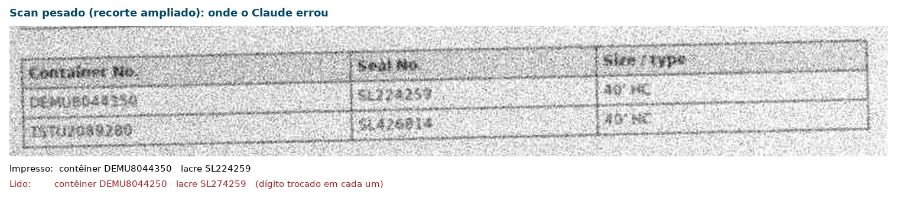

# extrator-comex

Extrai dados de **Invoice**, **Packing List** e **BL** (PDF) para JSON validado, e mede a acurácia campo a campo.

```
PDF → Claude (saída estruturada, schema Pydantic) → validadores → JSON final ou "revisar"
```

Só usa documentos **sintéticos** (nomes fictícios). Documento real de cliente não entra neste repositório.



*A mesma invoice sintética em três tipos de PDF. Os dois scans não têm camada de texto: o Claude precisa ler a imagem.*

## O que o projeto entrega

1. **Schemas** (`schemas.py`): um por documento, com tipos e campos obrigatórios.
2. **Validadores** (`validators.py`): regras que o modelo não consegue garantir sozinho.
   - quantidade x preço = total do item; soma dos itens = total da invoice
   - peso líquido não pode passar do bruto; soma dos itens = total do packing list
   - contêiner no formato ISO 6346 e com dígito verificador correto; sem duplicado
   - entre documentos: invoice citada no packing list, quantidade total, peso bruto (1% de tolerância) e volumes entre packing list e BL
   - avisos (não bloqueiam): embarcador ≠ exportador, consignee ≠ importador
3. **Pipeline** (`pipeline.py`): extrai, valida, devolve `status: "ok"` ou `"revisar"` com o código de cada problema. Se um documento não extrai, os outros seguem e o conjunto vai para revisão.
4. **Eval** (`evaluate.py`): acerto por campo, por documento, defeitos injetados detectados, falsos alarmes e **erros de extração que passaram sem revisão**.

## Como rodar

```bash
python -m venv .venv
.venv\Scripts\activate
pip install -e .[dev]

pytest                                      # testes, sem API
python -m extrator gerar --n 40 --defeitos 10
python -m extrator avaliar --extrator simulado   # sem API
```

### PDFs "sujos" (mais perto do real)

```bash
python -m extrator gerar-sujo --n 6          # 18 conjuntos em data/sujo
python -m extrator avaliar --extrator claude-code --dados data/sujo --saida results/sujo
```

Três tipos, com os mesmos dados e gabarito dos limpos:

- **tabela** (`T`): PDF com texto, layout de formulário (caixas, grade, colunas) e campos que não estão no schema (PO, dados bancários, voyage, data de emissão do BL, coluna de caixas).
- **scan_leve** (`L`): só imagem (sem camada de texto), 150 dpi, rotação até 1°, ruído e desfoque leves.
- **scan_pesado** (`P`): só imagem, 100 dpi, rotação até 2,5°, ruído forte, baixo contraste, JPEG comprimido e carimbo.

O PDF escaneado não tem texto, então o modo `auto` cai para `pdf` (consome mais tokens). O relatório separa o resultado por tipo.



*Scan pesado, em uma das rodadas: o Claude leu 8044**2**50 em vez de 8044**3**50 no contêiner e 27 em vez de 22 no lacre. O dígito verificador do contêiner pegou o erro e mandou o conjunto para revisão. O lacre não tem dígito verificador.*

As imagens são geradas por `python scripts/imagens_readme.py`.

### Sem chave de API: usando o Claude Code (assinatura)

O extrator `claude-code` chama `claude -p` com o login da sua assinatura. Não precisa de chave de API.
O padrão é o modelo `haiku` com esforço `low`.

```bash
python -m extrator avaliar --extrator claude-code --limite 10
python -m extrator processar --invoice a.pdf --packing-list b.pdf --bl c.pdf
```

Opções: `--modo auto|texto|pdf`, `--modelo haiku|sonnet|opus`, `--esforco low|medium|high`.

- **texto** extrai o texto do PDF localmente e manda no prompt, sem ferramentas.
- **pdf** deixa o Claude ler o PDF (serve para PDF escaneado).
- **auto** (padrão) usa texto e cai para pdf quando o PDF não tem texto.

O consumo cai porque a chamada roda sem ferramentas nem conectores (`--tools`, `--strict-mcp-config`, `--disable-slash-commands`).
Sem isso, uma chamada passou de 100 mil tokens.

### Com a API (precisa de `ANTHROPIC_API_KEY`)

```bash
python -m extrator avaliar --extrator claude-api
```

O modelo padrão é `claude-opus-5-5`. Para trocar: variável de ambiente `EXTRATOR_MODELO`.

## Consumo medido (tokens por chamada, 10 conjuntos sintéticos)

| Configuração | Chamadas | Média | Mediana | Acerto |
|---|---|---|---|---|
| texto, haiku, esforço low (padrão) | 30 | 4.590 | 4.586 | 100% |
| texto, modelo padrão do Claude Code | 30 | 4.318 | 4.364 | 100% |
| pdf (leitura do PDF), modelo padrão | 9 | 11.408 | 11.469 | 100% |

Tokens = entrada + cache + saída. Em preço de lista, as 30 chamadas do padrão equivalem a US$ 0,02.
Cada conjunto de 3 documentos gasta cerca de 14 mil tokens.

## Leia isto antes de citar números

- O eval **simulado** devolve o gabarito com erros sorteados. Ele só prova que a régua funciona. **Não mede o Claude.**
- Os 100% acima vêm do Claude Code com o pipeline oficial, mas só em **10 conjuntos sintéticos**. Os PDFs são limpos (texto gerado, sem scan, sem carimbo, sem layout de verdade). Em documento real a acurácia será menor. O próximo passo honesto é montar um conjunto anonimizado de documentos reais.
- **PDFs sujos** (haiku, low, 6 conjuntos: 2 de cada tipo, nenhum com defeito injetado): `tabela` e `scan_leve` 100% corretos; `scan_pesado` 0 de 2 conjuntos corretos, com troca de dígitos (1↔7, 4↔5, 8↔2) em quantidade, peso, contêiner e lacre. Os validadores mandaram os 2 para revisão (0 erros silenciosos), mas o lacre não tem dígito verificador e só seria pego por acaso. Na primeira rodada o `bl.navio` saiu com o número da viagem junto; a regra foi para o prompt e o campo foi a 100%. Amostra pequena: serve de indício, não de taxa. Relatórios em `results/sujo` (antes do ajuste) e `results/sujo_v2`.
- **Modelo no scan pesado** (6 conjuntos, 18 chamadas cada, modo `pdf`):

  | | Haiku, low | Sonnet, medium |
  |---|---|---|
  | Documentos 100% corretos (invoice / romaneio / BL) | 67% / 0% / 17% | 83% / 33% / 67% |
  | Conjuntos com algum erro de extração | 6 de 6 | 5 de 6 |
  | Conjuntos enviados para revisão | 6 de 6 | 4 de 6 |
  | **Erros que passaram sem revisão** | 0 | **1** |
  | Tokens por chamada (média) | 12.631 | 11.940 |
  | Preço de lista das 18 chamadas | US$ 0,03 | US$ 0,42 |

  O Sonnet acerta mais (contêiner 100%), mas manda menos conjuntos para revisão e deixou passar 1 erro. Os campos que sobram errados, como lacre e data, não têm conferência por código. Melhor extração não dispensa a conferência: o que mais importa é o número de erros silenciosos, não o acerto. Mesma ressalva de sempre: amostra pequena, sem defeitos injetados além de 1, resultado varia de uma rodada para outra. Relatórios em `results/sujo_pesado` e `results/sujo_pesado_sonnet`.
- O modo `texto` não foi testado em PDF escaneado. O modo `pdf` também só foi testado em PDFs sintéticos com texto.
- O extrator `claude-api` **ainda não foi executado** (faltou chave). Os testes dele usam um cliente falso e conferem o fluxo: PDF enviado, nova tentativa quando a validação falha, recusa e corte tratados.
- Se a API recusar o pedido (`stop_reason = refusal`), o documento vai para revisão. Não há modelo de fallback configurado.
- Quando o limite da assinatura acaba, o eval para com uma mensagem, em vez de registrar falhas falsas. Essa detecção usa o texto do erro e nunca foi acionada de verdade.

## Limites conhecidos

- BL sem contêiner (carga solta) não passa no schema (`conteineres` exige ao menos um).
- Moeda só é checada contra uma lista de moedas comuns de comex.
- O eval compara itens por posição: se o extrator trocar a ordem dos itens, conta como erro.

## Estrutura

```
src/extrator/   schemas, validators, pipeline, extractor, synthetic, sujo, simulado, evaluate
tests/          validadores, extrator (cliente falso), eval
data/sintetico/ pdf/ e gabarito/ gerados por `python -m extrator gerar`
data/sujo/      idem, gerados por `python -m extrator gerar-sujo`
```
